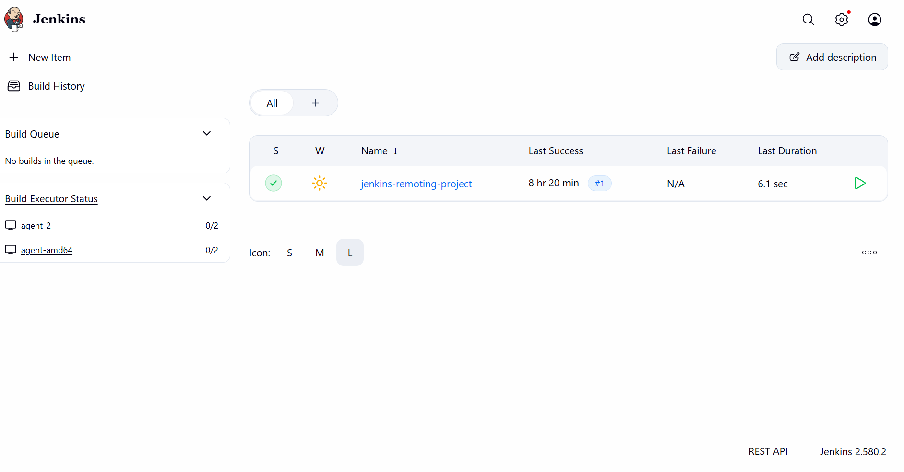
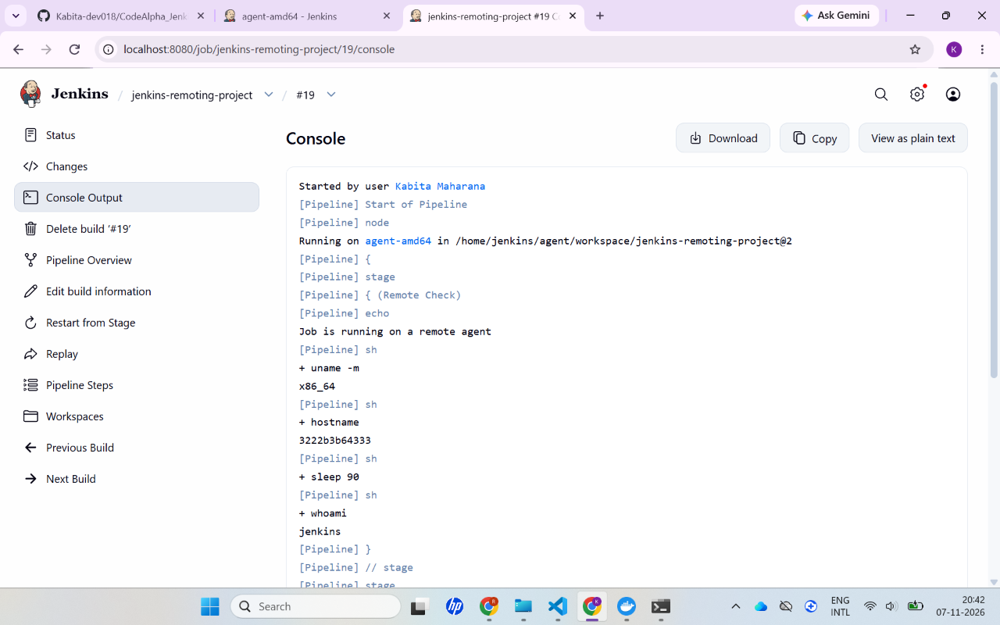
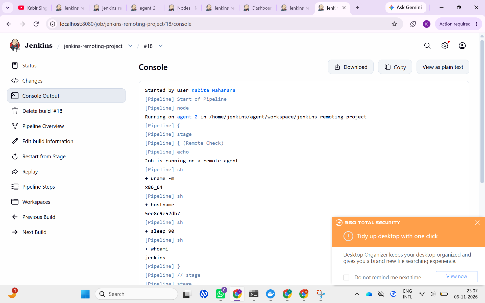
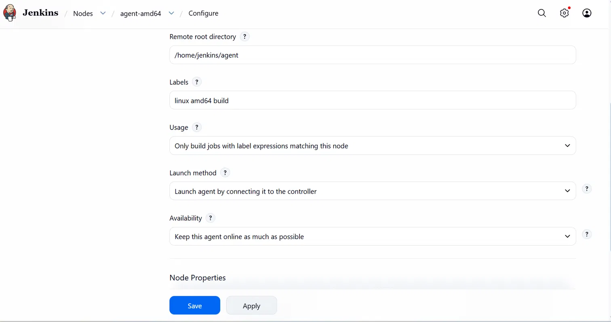

# CodeAlpha Jenkins Remoting Project: Controller + Remote Agents

This project sets up a Jenkins controller that runs **no builds itself** and delegates all work to **remote agents** connected through Jenkins **Remoting** (inbound / "Launch agent by connecting it to the controller").

## 1. Objectives

1. Connect remote nodes to a Jenkins controller using Remoting.
2. Make sure builds run on the agents, not on the controller.
3. Show load distribution across multiple agents (Linux amd64).
4. Apply basic security practices (secrets, non-root user, label restriction).

## 2. Architecture

```
                 +---------------------------+
                 |  Jenkins Controller       |
                 |  (Built-In Node, 0 exec)  |
                 |  http://localhost:8080    |
                 +-------------+-------------+
                               |  Remoting (JNLP / WebSocket, port 50000)
              +----------------+----------------+
              |                                 |
   +----------v-----------+         +-----------v----------+
   | agent-amd64          |         | agent-2              |
   | Linux (amd64)        |         | Linux (amd64)        |
   | 2 executors          |         | 2 executors          |
   | labels: linux amd64  |         | labels: linux amd64  |
   |         build        |         |         build        |
   +----------------------+         +----------------------+
```

| Node | Architecture | Role | Executors |
|---|---|---|---|
| Built-In Node | Linux (amd64) | Controller only | 0 |
| agent-amd64 | Linux (amd64) | Remote agent #1 | 2 |
| agent-2 | Linux (amd64) | Remote agent #2 | 2 |

Jenkins version: **2.580.2**

## 3. Setup

### 3.1 Controller
- Start Jenkins (Docker or local) on `http://localhost:8080`.
- **Manage Jenkins → Nodes → Built-In Node → Configure**: set **Number of executors = 0** so no build runs on the controller.

### 3.2 Create the agent nodes
For each agent (`agent-amd64`, `agent-2`):

1. **Manage Jenkins → Nodes → New Node**, give it the name, choose *Permanent Agent*.
2. Configure:
   - **Remote root directory:** `/home/jenkins/agent`
   - **Number of executors:** 2
   - **Labels:** `linux amd64 build`
   - **Usage:** *Only build jobs with label expressions matching this node*
   - **Launch method:** *Launch agent by connecting it to the controller*
   - **Availability:** *Keep this agent online as much as possible*
3. Save, then open the node page to get the agent **secret** (never commit it).

### 3.3 Start the agents (Docker)

Replace the placeholders with your own values (use the real secret locally, never in Git):

```bash
docker run -d --name agent-amd64 \
  -e JENKINS_URL=http://<CONTROLLER_HOST>:8080 \
  -e JENKINS_AGENT_NAME=agent-amd64 \
  -e JENKINS_SECRET=<SECRET_FROM_NODE_PAGE> \
  -e JENKINS_AGENT_WORKDIR=/home/jenkins/agent \
  jenkins/inbound-agent

docker run -d --name agent-2 \
  -e JENKINS_URL=http://<CONTROLLER_HOST>:8080 \
  -e JENKINS_AGENT_NAME=agent-2 \
  -e JENKINS_SECRET=<SECRET_FROM_NODE_PAGE> \
  -e JENKINS_AGENT_WORKDIR=/home/jenkins/agent \
  jenkins/inbound-agent
```

> If the agents run in containers and the controller runs on the Windows host, use `host.docker.internal` as `<CONTROLLER_HOST>`, or put both on the same Docker network.

Both nodes show as online on **Manage Jenkins → Nodes**.

## 4. Pipeline

The job `jenkins-remoting-project` is a Pipeline job (see [`Jenkinsfile`](Jenkinsfile)):

```groovy
pipeline {
    agent { label 'linux && build' }

    stages {
        stage('Remote Check') {
            steps {
                echo 'Job is running on a remote agent'
                sh 'uname -m'
                sh 'hostname'
                sh 'sleep 30'
                sh 'whoami'
            }
        }
    }
}
```

The `sleep` keeps each build running long enough to observe parallel execution. For the load test below it was raised to `sleep 90`.

## 5. Load test

**Method:** Build Now was clicked 6 times in quick succession.

**Result** (4 executors in total, 2 per agent):

| Build | Where it ran |
|---|---|
| #17 | agent-amd64 |
| #19 | agent-amd64 |
| #18 | agent-2 |
| #20 | agent-2 |
| #21, #22 | Waited in the Build Queue until an executor was free |

- Both agents showed **2/2** executors busy at the same time.
- The Built-In Node did not appear in Build Executor Status, so **no build ran on the controller**.
- Console output confirms the node and hostname per build, for example build #19: `Running on agent-amd64`, `uname -m` → `x86_64`, `hostname` → `3222b3b64333`, `whoami` → `jenkins`.

## 6. Security measures

- **Controller has 0 executors:** untrusted build code never runs on the controller.
- **Label restriction:** agents use *Only build jobs with label expressions matching this node*, so only jobs that ask for `linux && build` land there.
- **Non-root builds:** builds run as the `jenkins` user (`whoami` → `jenkins`).
- **Secrets are not committed:** agent secrets are passed via environment variables and appear in this repo only as `<SECRET_FROM_NODE_PAGE>`. `.gitignore` excludes `.env` and secret files.
- **Dedicated workspace:** each agent uses its own remote root `/home/jenkins/agent`.

## 7. Screenshots

### Nodes page (all 3 nodes online)


### Build Executor Status (load distribution)


### Console output: agent-amd64


### Console output: agent-2


### Node configuration (label + only matching label + inbound launch)


## 8. Other architectures (arm64): not done yet

Both agents here are Linux amd64. To cover additional architectures, run an agent on an arm64 machine (or an arm64 container image through emulation), create a node such as `agent-arm64` with the label `arm64`, and target it from a pipeline with `agent { label 'arm64' }`.

## 9. Repository layout

```
jenkins-remoting-project/
├── README.md
├── Jenkinsfile
├── .gitignore
├── docker-compose.yml   (optional)
└── screenshots/
    ├── 01-nodes.png
    ├── 02-executor-status.png
    ├── 03-console-agent-amd64.png
    ├── 04-console-agent-2.png
    └── 05-node-configure.png
```
## 10. Author

**Kabita Maharana**
Email: kabitamahara567@gmail.com
CodeAlpha Internship, Task 2